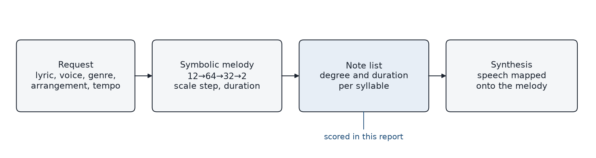
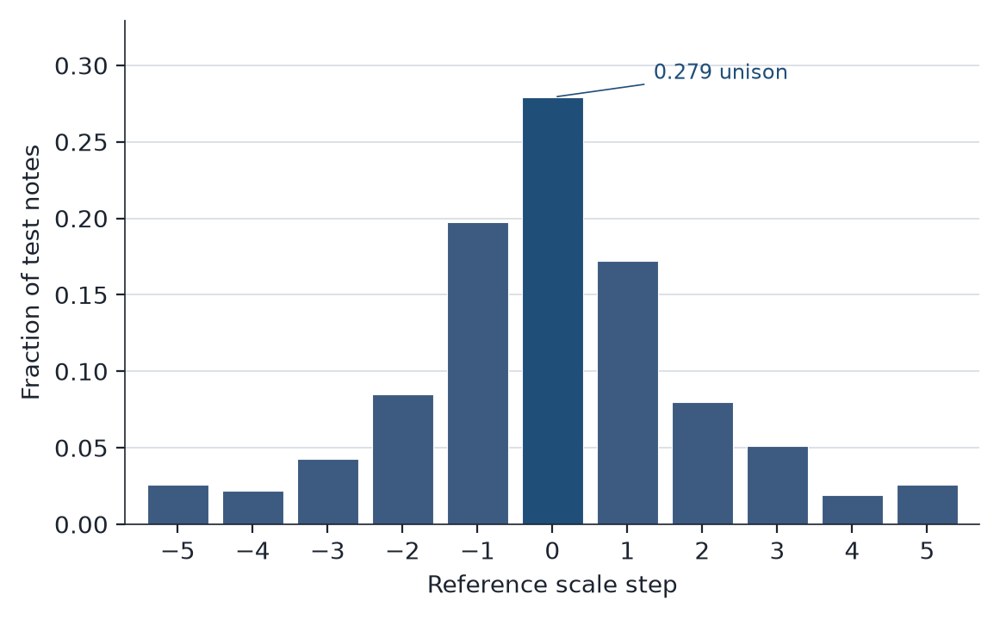
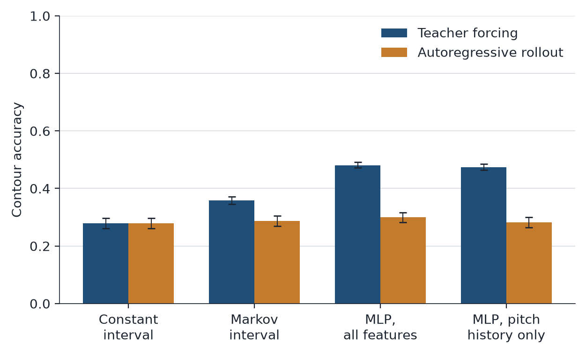

# Feature Dependence in a Syllable-Level Vocal Melody Model

Aditya Bakshi  
October 2026

## Abstract

This report quantifies the individual feature contributions driving generalization accuracy in Calliope, a text-to-vocal generative model. Calliope predicts a scale-degree interval and a rhythmic duration for each lyric syllable using a multilayer perceptron (12→64→32→2) optimized via mean squared error. We evaluate holdout performance across 19,779 test notes from the OpenScore Lieder v3.0.0 corpus (1,348 total compositions; 270 held out).

Under teacher-forced validation, the network achieves a directional contour accuracy of 0.481, against 0.359 for a first-order Markov baseline, with non-overlapping 95% bootstrap intervals. A model restricted to the prior two scale degrees retains a contour accuracy of 0.474, matching the full network within uncertainty. Removing vowel identity and token length yields an interval mean absolute error (MAE) of 1.304, compared with 1.307 for the full feature set. Duration error is matched by a four-bin phrase-position median (0.410 versus 0.405). Under autoregressive rollout, the condition used during generation, contour accuracy falls to 0.300, and interval error across models lies near 1.40 scale degrees.

## 1. Introduction

Automated text-to-vocal architectures require a symbolic sequence processor to map text to discrete musical pitches and durations before waveform synthesis occurs. Within the Calliope framework, this symbolic mapping is executed by a compact autoregressive network conditioned on syllable position, a coarse phonetic code, phrase structure, and the two preceding scale degrees. These inputs were selected under the hypothesis that phonetic and structural features of the text should shape the melodic contour. Determining whether these representations provide measurable predictive value is an empirical question.

This study evaluates symbolic predictive accuracy. For every held-out note, we score the predicted scale step and duration against the reference under two protocols:

- Teacher forcing, in which historical context is drawn from the reference sequence, estimates next-step accuracy given a correct history.
- Autoregressive rollout, in which the model conditions on its own prior predictions, simulates generation.

Performance is compared with three statistical baselines: a constant interval predictor, a first-order Markov interval model, and a phrase-position duration table. Feature groups are isolated by retraining with the corresponding inputs set to zero.

The directional advantage over the Markov baseline is carried by short-term pitch memory. The lyric features, as currently parameterized, do not reduce interval error, and duration predictions are largely a function of phrase position. The teacher-forced contour gain does not persist once the model operates autoregressively.

## 2. System Architecture

Calliope is a local music production environment. Generate vocal starts from text rather than from an acoustic reference. A request specifies the lyric, vocal profile, genre, arrangement, and tempo. The pipeline then divides into a symbolic planner and a synthesis stage.

In the symbolic stage, `melody_from_lyrics` segments the text into syllables and phrases. The network in `vocal_melody_ml.py` maps each syllable to a scale-degree step and a duration in quarter-note beats. Those degrees are realized as MIDI pitches in the key and tessitura implied by the genre and voice. Beats are converted to seconds at the target tempo. Weights are stored in `vocal_melody_mlp.npz` and evaluated in NumPy. If that file is absent, the same interface substitutes a deterministic step pattern.

Synthesis follows the note list. The default renderer speaks the lyric and maps that speech onto the melody. A formant source–filter synthesizer is the fallback. DiffSinger is an optional backend and is outside the scope of the measurements below.

The network is a feedforward map applied left to right. Its twelve inputs are:

1. Normalized position in the song
2. Phrase index
3. Phrase-final indicator
4. Phrase-initial indicator
5. Vowel identity
6. Token length
7. Genre
8. Arrangement
9. Previous scale degree
10. Scale degree before that
11. Center of the voice range
12. Indicator for the second half of the song

During generation, inputs 9 and 10 are filled from degrees the model has already emitted, so an error at one syllable changes the conditioning context of every syllable after it. Inputs 9 and 10 are degree indices, not intervals. The Markov baseline, by contrast, conditions on the previous interval. All metrics in this report are computed on the symbolic sequence, before synthesis.



*Figure 1.* Generate vocal writes a symbolic note list before synthesis. The measurements in this report are taken on that note list.

## 3. Dataset and Preprocessing

Scores are taken from OpenScore Lieder v3.0.0 (Gotham and Jonas, [10.5281/zenodo.15450144](https://doi.org/10.5281/zenodo.15450144)), released under CC0. Of 1,356 MuseScore files, 1,348 contain a vocal staff of at least six notes and parse successfully. Each pitch is mapped to the nearest degree of a scale pool in the song’s inferred key, restricted to the tessitura of the voice class implied by the median pitch of the line (soprano, alto, tenor, or bass).

Sequences are truncated at 80 notes, matching the trainer. The reference interval of the first note is measured from the midpoint of the scale pool, matching initialization at generation time. Figure 2 shows the resulting steps on the test songs. The mode is a unison.



*Figure 2.* Reference scale steps on the 19,779 held-out notes, clipped to the range −5 to +5, as in the training target. The bar at 0 is the unison rate used in Section 5.1.

The split is by composition, with seed 7 and a holdout fraction of 0.2: 1,078 songs (78,960 notes) for training and 270 songs (19,779 notes) for test. No composition contributes notes to both partitions.

At deployment, genre and arrangement vary with the request, and predicted degrees are interpreted in the key of the selected genre. On this corpus both fields are constant: every row is coded acoustic and through-composed, so those input columns have standard deviation zero. They are retained so the evaluated network has the same input layout as the deployed one. Their contribution cannot be estimated from these songs; that limit is stated in Section 7.

## 4. Methodology

### 4.1 Model and objective

The predictor is a multilayer perceptron with rectified linear hidden layers of 64 and 32 units. Optimization uses Adam for at most 250 iterations, with early stopping. Fitted models terminated between iterations 70 and 130.

The targets are the scale-degree interval and the base-2 log duration. Intervals are clipped to the range −5 to +5 before the loss is computed, so leaps beyond five scale degrees lie outside the training objective. The objective is mean squared error. At inference the interval output is rounded to an integer step and added to the running degree. The duration output is converted back to quarter-note beats and clipped to the range 0.25 to 4.

Squared error estimates a conditional mean. When the distribution over intervals is dispersed, that mean need not equal the modal interval, and rounding it need not recover the mode.

### 4.2 Ablations

Each ablation retrains the same architecture after the named inputs are set to zero. Parameter count is unchanged.

- Lyric ablation. Vowel identity and token length are zero.
- Phrase ablation. Phrase index, phrase-initial and phrase-final indicators, and the second-half indicator are zero.
- Pitch history only. Every input is zero except the previous scale degree and the degree before it.
- Cadence mixture. Training rows are augmented with 120 synthetic cadence songs, the mixture used so that genre and arrangement are not constant in the deployed training recipe.

### 4.3 Baselines

Baselines are fit on the training partition only.

- Constant interval. Predict the median training interval at every step. That median is 0, as is the modal interval, so the rule is a unison: remain on the current degree. Duration is the median training duration, 0.5 beats.
- Markov interval. Predict the median interval conditioned on the previous interval, with both clipped to the range −5 to +5. The first note uses the median opening interval. Duration remains the global median.
- Phrase-position duration. The Markov interval, with duration taken from four bins: phrase start, early, late, and phrase final. On the training songs those medians are 0.5, 0.5, 0.5, and 1.0 beats.

### 4.4 Metrics and uncertainty

Reported values are note-weighted over the 19,779 test notes. Brackets are 95% percentile intervals from 1,000 bootstrap resamples of the 270 test songs (seed 11). Song-macro interval MAE differs from the note-weighted value by less than 0.003, so the aggregates are not driven by a small number of long songs.

- Interval MAE. Mean absolute deviation, in scale degrees, between the integer step taken and the reference step. Reference steps are clipped to the range −5 to +5, consistent with the training target.
- Duration MAE. Mean absolute deviation in quarter-note beats.
- Contour accuracy. Fraction of steps whose direction agrees with the reference: down, unison, or up.
- Degree accuracy. Fraction of steps whose scale degree equals the reference degree.

### 4.5 Evaluation protocols

Under teacher forcing, the degree inputs at each step are the reference degrees. An incorrect prediction does not enter the context of later steps. This protocol estimates next-note accuracy given a correct history.

Under autoregressive rollout, the degree inputs are the degrees the model has itself produced. This is the conditioning used by Generate vocal. For the full model, rollout interval MAE, duration MAE, and degree accuracy agree with `evaluate_songs` in the training code.

## 5. Results

### 5.1 Teacher-forced prediction

| Model | Interval MAE | Duration MAE | Contour accuracy | Degree accuracy |
| --- | ---: | ---: | ---: | ---: |
| Constant interval | 1.403 [1.360, 1.444] | 0.445 [0.416, 0.475] | 0.279 [0.261, 0.297] | 0.279 |
| Markov interval | 1.360 [1.322, 1.395] | 0.445 [0.416, 0.475] | 0.359 [0.345, 0.372] | 0.276 |
| Markov + phrase duration | 1.360 [1.322, 1.395] | 0.410 [0.384, 0.440] | 0.359 [0.345, 0.372] | 0.276 |
| MLP, all features | 1.307 [1.277, 1.335] | 0.405 [0.388, 0.424] | 0.481 [0.472, 0.492] | 0.250 |
| MLP, lyric features removed | 1.304 [1.276, 1.331] | 0.425 [0.407, 0.443] | 0.479 [0.470, 0.490] | 0.253 |
| MLP, phrase features removed | 1.311 [1.282, 1.339] | 0.423 [0.405, 0.441] | 0.482 [0.473, 0.493] | 0.249 |
| MLP, pitch history only | 1.315 [1.284, 1.344] | 0.443 [0.425, 0.461] | 0.474 [0.465, 0.485] | 0.254 |
| MLP + cadence songs | 1.302 [1.273, 1.331] | 0.405 [0.388, 0.423] | 0.480 [0.470, 0.491] | 0.253 |

Contour accuracy separates the network from the Markov baseline: 0.481 [0.472, 0.492] against 0.359 [0.345, 0.372]. The pitch-history model reaches 0.474 [0.465, 0.485], which overlaps the full model. The lyric ablation leaves interval MAE at 1.304 [1.276, 1.331], against 1.307 [1.277, 1.335] for the full model. The phrase ablation leaves it at 1.311 [1.282, 1.339]. Under teacher forcing, vowel identity, token length, and phrase position do not account for the contour gain.

Interval MAE falls from 1.360 [1.322, 1.395] for the Markov model to 1.307 [1.277, 1.335] for the full network, a difference of about 0.05 scale degrees. The intervals overlap, so the reduction is not resolved by the song-level bootstrap.

Degree accuracy moves in the other direction, from 0.279 for the constant interval to 0.250 for the full network. The constant rule is a unison, and Figure 2 shows that 0.279 of reference steps are unisons, which is why that rule’s contour accuracy and degree accuracy coincide. A squared-error model predicts a conditional mean. When that mean lies between 0 and a small nonzero step, rounding misses a fraction of the exact unisons while reducing absolute error on the steps that move.

Duration MAE for the full model is 0.405 [0.388, 0.424], against 0.410 [0.384, 0.440] for the phrase-position table; the intervals overlap. Removing phrase inputs raises duration MAE to 0.423 [0.405, 0.441]. The pitch-history model reaches 0.443 [0.425, 0.461], and that interval does not meet the full model’s. The medians behind the table are an eighth note within the phrase and a quarter note on the phrase-final syllable. Adding the 120 synthetic cadence songs leaves interval and duration MAE within 0.005 of the Lieder-only model.

### 5.2 Autoregressive rollout

| Model | Interval MAE | Contour accuracy | Degree accuracy |
| --- | ---: | ---: | ---: |
| Constant interval | 1.403 [1.359, 1.446] | 0.279 [0.261, 0.296] | 0.146 |
| Markov interval | 1.397 [1.353, 1.439] | 0.287 [0.269, 0.304] | 0.172 |
| MLP, all features | 1.403 [1.358, 1.445] | 0.300 [0.282, 0.317] | 0.176 |
| MLP, pitch history only | 1.402 [1.356, 1.444] | 0.282 [0.264, 0.300] | 0.161 |



*Figure 3.* Contour accuracy with 95% song-level bootstrap intervals. Teacher forcing scores the next step given the reference history. Rollout scores generation from the model’s own degrees. The pitch-history model matches the full network under teacher forcing; neither separates from the constant interval once generation is autoregressive.

Duration MAE is unchanged from Section 5.1. Phrase position is a function of the lyric, so the duration prediction does not depend on the realized pitches.

Interval error does. Relative to teacher forcing, full-model interval MAE rises from 1.307 [1.277, 1.335] to 1.403 [1.358, 1.445]; those intervals do not overlap. Every model lies near 1.40, and every contour interval overlaps the constant baseline. Full-model contour accuracy is 0.300 [0.282, 0.317], against 0.279 [0.261, 0.296] for a unison. The teacher-forced advantage of about 0.05 scale degrees does not control the trajectory: after the first disagreement, later degree inputs are the model’s degrees rather than the reference.

## 6. Discussion

The contour advantage over a Markov interval is carried by pitch history. The lyric encoding in the deployed model, a vowel identifier and a normalized token length, does not reduce interval MAE when those inputs are removed and the network is retrained. Phrase features likewise leave interval MAE within bootstrap uncertainty of the full model, and they do account for duration: without them, duration MAE moves back toward a constant eighth note, and the pitch-history duration interval separates from the full model.

The gap between interval MAE and degree accuracy follows from the objective. Unisons are the modal step. Minimizing squared error favors a mean that rounds away from a subset of those unisons. A categorical model over the eleven admissible intervals, from −5 to +5, is the alternative if degree accuracy is the quantity of interest. This experiment does not estimate that model.

A lyric representation that affected pitch would have to carry information beyond the previous degrees. Stress, metrical position, and lexical features are candidates. Vowel identity and character length do not supply it on OpenScore Lieder. Perceptual preference for the rendered line is a separate question, and it would involve the synthesis stage in Section 2 as well as the symbolic error measured here.

## 7. Limitations

The corpus is nineteenth-century art song. The same weights are used in Calliope for pop and rap lyrics, a domain on which these estimates do not speak. Agreement with a reference score is not a listening test. Eight files in the release failed to parse. Training targets clip intervals at five scale degrees, so larger leaps are not represented in the loss. Genre and arrangement have no variance in the design matrix. Ablations zero coordinates and retrain. They do not reduce width: a zeroed coordinate is multiplied by its weights and therefore drops out of the forward pass, while the biases remain free to fit the mean of the target.

## 8. Reproducibility

The corpus is not stored in the repository. OpenScore Lieder v3.0.0 should be unpacked at `data/openscore-lieder`, a gitignored path. From `backend/`:

```bash
PYTHONPATH=src .venv/bin/python -m calliope.audio.melody_eval
```

The command rewrites `docs/melody-holdout.json`, from which the tables and Figure 3 are taken. Figure 2 is recomputed on the same split by `python -m calliope.audio.melody_figures`, which also redraws the other two panels into `docs/figures/`. `backend/tests/test_melody_eval.py` checks that evaluation rows match the trainer’s feature construction, and that a sequence of identical steps has zero interval error under a predictor that emits that step.

Public use of the scores should credit OpenScore Lieder and link [the corpus](https://musescore.com/openscore-lieder-corpus) or [the repository](https://github.com/OpenScore/Lieder).
